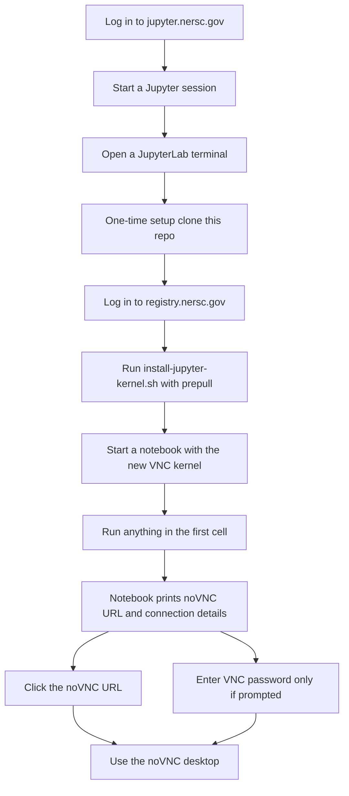
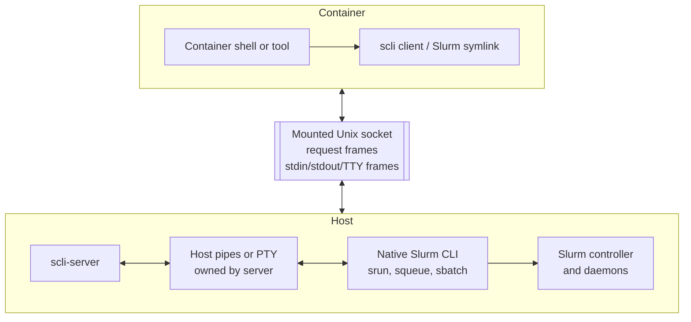
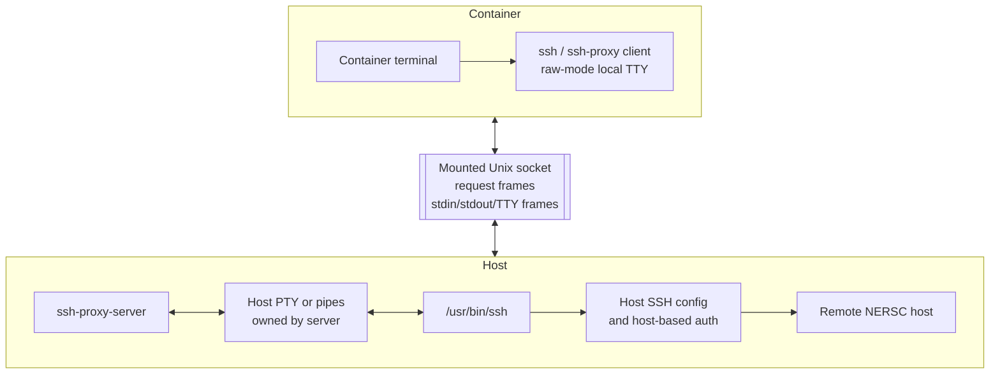
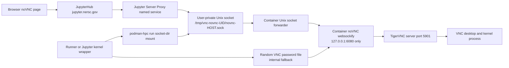

# VNC/noVNC Desktop Container for NERSC

This repository builds VNC/noVNC desktop containers for NERSC and provides
helpers for running them directly or as Jupyter kernels with `podman-hpc`.

The default image is Debian 12 with fvwm3:

```text
ghcr.io/dingp/vnc-novnc-container:debian-12-main
```

Images include TigerVNC, noVNC, Chromium, D-Bus session helpers, common fonts,
`sshproxy`, a desktop environment, terminal tools, common debugging/networking
tools, and Python `ipykernel` support. The `ubuntu gpu-xfce` variant is based on
NVIDIA CUDA 13.3 with cuDNN development libraries and adds OpenGL runtime
packages for GPU visualization GUIs. The VNC/noVNC helper code is installed in
the container under
`/usr/local/lib/vnc-novnc`; `/opt` is not used so host `/opt` mounts do not hide
it.

## Quickstart: Jupyter Kernel

1. Log in to <https://jupyter.nersc.gov>, start a Jupyter session, and open a
   JupyterLab terminal.

2. Clone this repository in the terminal:

```sh
cd "${HOME}"
git clone https://github.com/dingp/vnc-novnc-container.git
cd vnc-novnc-container
```

3. Pick the distro and desktop variant you want:

```sh
scripts/install-jupyter-kernel.sh --list-variants

DISTRO=ubuntu24.04
DESKTOP=xfce
```

Common choices include `debian12 fvwm3`, `debian12 xfce`, `ubuntu24.04 fvwm3`,
`ubuntu24.04 xfce`, `ubuntu24.04 xfce-slurm`, `ubuntu gpu-xfce`,
`alma9 fvwm3`, `alma9 xfce`, `opensuse15.6 xfce`, and
`opensuse15.6 xfce-slurm`.

4. Load the NERSC Python module, log in to the NERSC registry if you will pull
   images from `registry.nersc.gov`, and install the selected kernelspec.
   `--prepull` downloads the selected image during installation so the first
   kernel startup does not have to wait for an image pull.

```sh
module load python
podman-hpc login registry.nersc.gov
scripts/install-jupyter-kernel.sh "${DISTRO}" "${DESKTOP}" --prepull --force
```

To install every supported distro/desktop kernelspec and pre-pull every image:

```sh
module load python
podman-hpc login registry.nersc.gov
scripts/install-jupyter-kernel.sh --all --prepull --force
```

Pre-pulling all variants can take a while because it downloads every desktop
image.

To refresh images later without reinstalling kernelspecs:

```sh
module load python
scripts/install-jupyter-kernel.sh "${DISTRO}" "${DESKTOP}" --prepull-only
scripts/install-jupyter-kernel.sh --all --prepull-only
```

The `--all --prepull-only` form can also take a while because it pulls every
desktop image.

5. Refresh JupyterLab if needed, then create a new notebook with the
   `VNC-DISTRO-DESKTOP` kernel, for example `VNC-ubuntu24.04-xfce`.

The first notebook cell output shows the noVNC login URL and connection
details. Unix-socket kernels still create a random VNC password internally, but
the security boundary is the authenticated Jupyter Server Proxy path plus the
user-private Unix socket, not a host TCP noVNC port. If you need to show the
connection details again:

```python
import vnc_novnc

vnc_novnc.display_connection()
```

Open the noVNC URL in the browser. If noVNC prompts for a VNC password, use the
printed password; otherwise it can be ignored for Unix-socket kernels. Closing
the notebook stops the noVNC container.

The user workflow is:



## Quickstart: Manual noVNC Container

You can also run a desktop container directly from a terminal without installing
or selecting a Jupyter kernel.

1. In a JupyterLab terminal, clone the repo and choose an image:

```sh
cd "${HOME}"
git clone https://github.com/dingp/vnc-novnc-container.git
cd vnc-novnc-container

IMAGE=ghcr.io/dingp/vnc-novnc-container:ubuntu-24.04-xfce-main
```

Other published image tags are listed in the image variant table below.

2. Load the NERSC Python module and run the helper:

```sh
module load python
PYTHONPATH="${PWD}" scripts/run-vnc-novnc.py \
  --config scripts/run-vnc-novnc.yaml \
  --image "${IMAGE}"
```

The helper pulls the image if needed, starts it with `podman-hpc`, prints a
Jupyter Server Proxy noVNC URL, and prints a one-time VNC password. Open the URL
and enter the password.

Example output:

```text
Image: ghcr.io/dingp/vnc-novnc-container:ubuntu-24.04-xfce-main
noVNC: https://jupyter.nersc.gov/user/your-user-name/perlmutter-login-node/proxy/49967/vnc.html?port=443&host=jupyter.nersc.gov&path=user%2Fyour-user-name%2Fperlmutter-login-node%2Fproxy%2F49967
One-time VNC password: AbC123xY
VNC server port is not exposed on the host.
```

If you run the helper outside a Jupyter terminal, provide the Jupyter server name
so it can still print a proxied URL:

```sh
module load python
PYTHONPATH="${PWD}" scripts/run-vnc-novnc.py \
  --config scripts/run-vnc-novnc.yaml \
  --image "${IMAGE}" \
  --jupyter-proxy-server perlmutter-login-node
```

Leave the command running while you use the desktop. Press `Ctrl-C` in the
terminal to stop the noVNC container. The raw VNC port is not exposed unless you
explicitly add `--expose-vnc`.

## Image Variants

Each image variant lives under:

```text
images/<base-os>/<desktop>/Dockerfile
```

The build context is the repository root so variants can reuse shared files
from `container/` and `vnc_novnc/`.

| Variant | Dockerfile | Published tag |
| --- | --- | --- |
| Debian 12 + fvwm3 | `images/debian-12/fvwm3/Dockerfile` | `ghcr.io/dingp/vnc-novnc-container:debian-12-main` |
| Debian 12 + XFCE | `images/debian-12/xfce/Dockerfile` | `ghcr.io/dingp/vnc-novnc-container:debian-12-xfce-main` |
| Ubuntu 24.04 + fvwm3 | `images/ubuntu-24.04/fvwm3/Dockerfile` | `ghcr.io/dingp/vnc-novnc-container:ubuntu-24.04-fvwm3-main` |
| Ubuntu 24.04 + XFCE | `images/ubuntu-24.04/xfce/Dockerfile` | `ghcr.io/dingp/vnc-novnc-container:ubuntu-24.04-xfce-main` |
| Ubuntu 24.04 + XFCE + Slurm CLI proxy | `images/ubuntu-24.04/xfce-slurm/Dockerfile` | `ghcr.io/dingp/vnc-novnc-container:ubuntu-24.04-xfce-slurm-main` |
| Ubuntu CUDA + GPU XFCE | `images/ubuntu/gpu-xfce/Dockerfile` | `ghcr.io/dingp/vnc-novnc-container:ubuntu-gpu-xfce-main` |
| AlmaLinux 9 + fvwm3 | `images/alma-9/fvwm3/Dockerfile` | `ghcr.io/dingp/vnc-novnc-container:alma-9-fvwm3-main` |
| AlmaLinux 9 + XFCE | `images/alma-9/xfce/Dockerfile` | `ghcr.io/dingp/vnc-novnc-container:alma-9-xfce-main` |
| openSUSE Leap 15.6 + XFCE | `images/opensuse-15.6/xfce/Dockerfile` | `ghcr.io/dingp/vnc-novnc-container:opensuse-15.6-main` |
| openSUSE Leap 15.6 + XFCE + Slurm CLI proxy | `images/opensuse-15.6/xfce-slurm/Dockerfile` | `registry.nersc.gov/dseg/novnc:opensuse15.6-xfce-slurm` |
| openSUSE Leap 15.6 + XFCE + Slurm CLI proxy + Unix noVNC | `images/opensuse-15.6/xfce-slurm/Dockerfile` | `registry.nersc.gov/dseg/novnc:opensuse15.6-xfce-slurm-unix` |

AlmaLinux 10 fvwm3 and XFCE Dockerfiles are scaffolded under `images/alma-10/`,
but they are not in CI yet. `podman-hpc run` package probes against AlmaLinux
10.2 with CRB and EPEL 10 enabled did not find TigerVNC server, fvwm3, or a full
XFCE desktop stack.

## Build

At NERSC, build with `podman-hpc`:

```sh
podman-hpc build -f images/debian-12/fvwm3/Dockerfile -t ghcr.io/dingp/vnc-novnc-container:debian-12-main .
```

Build another variant by selecting its Dockerfile:

```sh
podman-hpc build -f images/debian-12/xfce/Dockerfile -t ghcr.io/dingp/vnc-novnc-container:debian-12-xfce-main .
podman-hpc build -f images/ubuntu-24.04/fvwm3/Dockerfile -t ghcr.io/dingp/vnc-novnc-container:ubuntu-24.04-fvwm3-main .
podman-hpc build -f images/ubuntu-24.04/xfce/Dockerfile -t ghcr.io/dingp/vnc-novnc-container:ubuntu-24.04-xfce-main .
podman-hpc build -f images/ubuntu-24.04/xfce-slurm/Dockerfile -t ghcr.io/dingp/vnc-novnc-container:ubuntu-24.04-xfce-slurm-main .
podman-hpc build -f images/ubuntu/gpu-xfce/Dockerfile -t ghcr.io/dingp/vnc-novnc-container:ubuntu-gpu-xfce-main .
podman-hpc build -f images/alma-9/fvwm3/Dockerfile -t ghcr.io/dingp/vnc-novnc-container:alma-9-fvwm3-main .
podman-hpc build -f images/alma-9/xfce/Dockerfile -t ghcr.io/dingp/vnc-novnc-container:alma-9-xfce-main .
podman-hpc build -f images/opensuse-15.6/xfce/Dockerfile -t ghcr.io/dingp/vnc-novnc-container:opensuse-15.6-main .
podman-hpc build -f images/opensuse-15.6/xfce-slurm/Dockerfile -t registry.nersc.gov/dseg/novnc:opensuse15.6-xfce-slurm .
podman-hpc build -f images/opensuse-15.6/xfce-slurm/Dockerfile -t registry.nersc.gov/dseg/novnc:opensuse15.6-xfce-slurm-unix .
```

The `ubuntu gpu-xfce` kernelspec generated by `scripts/install-jupyter-kernel.sh`
sets `gpu: true` in the kernelspec YAML. For manual runs, pass `--gpu` to the
Python runner:

```sh
PYTHONPATH="${PWD}" scripts/run-vnc-novnc.py \
  --config scripts/run-vnc-novnc.yaml \
  --image ghcr.io/dingp/vnc-novnc-container:ubuntu-gpu-xfce-main \
  --gpu
```

The `ubuntu24.04 xfce-slurm` and `opensuse15.6 xfce-slurm` images include the
`scli` client and Slurm command symlinks (`srun`, `sbatch`, `squeue`, and
related commands). They also include an `ssh` shim that can proxy SSH through a
host-side `ssh-proxy-server`, which lets container shells use the host's SSH
configuration and host-based authentication for destinations such as NERSC DTNs.
The openSUSE Slurm variant also installs native GCC 7, 12, 13, and 14 packages
to match Perlmutter host compiler module expectations more closely. The Slurm
proxy code comes from the internal
[`slurm-cli-proxy`](https://gitlab.nersc.gov/nersc/nersc-user-env/experimental/slurm-cli-proxy)
project. Slurm-enabled kernelspecs set `gpu: true`, which adds `--gpu` to
`podman-hpc run` so host GPUs are visible in the container. This does not yet
make the VNC display itself use GPU-accelerated OpenGL rendering; Xvnc uses Mesa
software rendering today. VirtualGL/EGL integration for hardware-accelerated
OpenGL inside the VNC display is planned for a future update. Installing a
Slurm-enabled kernelspec builds the host-side
`scli-server` into `${HOME}/bin/scli-server` and `ssh-proxy-server` into
`${HOME}/bin/ssh-proxy-server`. With `--slurm`, the launcher starts
`scli-server` if the socket is not already present, then mounts the Unix socket
and sets `SCLI_SOCKET` inside the container. With `--ssh-proxy`, it does the
same for `ssh-proxy-server` and `SSH_PROXY_SOCKET`. Socket defaults are
hostname-qualified to avoid stale sockets when `${HOME}` is shared across login
nodes:

```text
SCLI_SOCKET, then ${XDG_RUNTIME_DIR}/scli-$(hostname).sock,
then /tmp/vnc-novnc-$(id -u)/scli-$(hostname).sock

SSH_PROXY_SOCKET, then ${XDG_RUNTIME_DIR}/ssh-proxy-$(hostname).sock,
then /tmp/vnc-novnc-$(id -u)/ssh-proxy-$(hostname).sock
```

The Slurm proxy carries command requests and interactive I/O over the mounted
Unix socket. The container client does not directly attach to a host TTY; when
TTY mode is requested, the host-side server owns the host PTY or pipe endpoints
and sends stdin/stdout/stderr frames through the socket.



The SSH proxy uses the same framing model. The container-side `ssh` shim puts
the local container terminal into raw mode when needed, but the real host SSH
process talks to a host-side PTY or pipes managed by `ssh-proxy-server`.



```sh
PYTHONPATH="${PWD}" scripts/run-vnc-novnc.py \
  --config scripts/run-vnc-novnc.yaml \
  --image registry.nersc.gov/dseg/novnc:opensuse15.6-xfce-slurm \
  --gpu \
  --slurm \
  --ssh-proxy
```

## Repository Layout

- `images/<base-os>/<desktop>/Dockerfile`: image variants.
- `container/`: shared entrypoints and desktop config.
- `vnc_novnc/`: host and in-container Python helpers.
- `kernels/`: sample Jupyter kernelspec.
- `scripts/`: install and run helpers.

## Run A Desktop

The preferred runner is the Python helper:

```sh
scripts/run-vnc-novnc.py --config scripts/run-vnc-novnc.yaml
```

It starts the image with `podman-hpc`, generates a one-time VNC password, stores
the password in a temporary `0600` file, publishes only the noVNC port by
default, and prints the noVNC URL. It also generates a Jupyter Server Proxy URL
when it can determine the Jupyter user/server prefix.

The legacy shell helper is still available for the default image:

```sh
scripts/run-vnc-novnc.sh
```

The Python helper is more complete: it supports YAML defaults, image
preparation, bind mounts, environment passthrough, user namespace handling, and
extra `podman-hpc` arguments.

Example output:

```text
Image: ghcr.io/dingp/vnc-novnc-container:debian-12-main
noVNC: https://jupyter.nersc.gov/user/your-user-name/muller-login-node-base/proxy/49967/vnc.html?port=443&host=jupyter.nersc.gov&path=user%2Fyour-user-name%2Fmuller-login-node-base%2Fproxy%2F49967
One-time VNC password: AbC123xY
VNC server port is not exposed on the host.
```

Open the printed noVNC URL and enter the printed one-time VNC password.

## Runner Configuration

The included `scripts/run-vnc-novnc.yaml` uses `--userns=keep-id`,
`--group-add=keep-groups`, and bind mounts the NERSC global filesystem,
`$SCRATCH`, `$CFS`, `/opt`, the host Cray PE config, the host cluster name,
and the host `/etc/environment`. Environment variables in YAML strings are
expanded on the host when the script starts.

YAML keys use long option names with underscores instead of dashes:

```yaml
userns: keep-id
keep_groups: true
pull_policy: missing
display_mode: default
gpu: false

volume:
  - "/global:/global"
  - "${SCRATCH}:${SCRATCH}:rw"
  - "${CFS}:${CFS}:rw"
  - "/opt:/opt"
  - "/etc/cray-pe.d:/etc/cray-pe.d:ro"
  - "/etc/clustername:/etc/clustername:ro"
  - "/etc/environment:/etc/environment:ro"

env:
  - "HOME"
  - "MODULEPATH"
  - "MODULEPATH_ROOT"
  - "MODULESHOME"
  - "PE_ENV"
  - "LMOD_FAMILY_MPI"
  - "LMOD_FAMILY_CUDATOOLKIT"
  - "LMOD_FAMILY_CUDATOOLKIT_VERSION"
```

Precedence is: built-in defaults, YAML config, environment variables, then
command-line arguments. Repeated list options such as `volume`, `mount`, `env`,
`group_add`, and `extra_podman_args` are initialized from YAML, and additional
command-line occurrences are appended.

Common settings:

| Variable | Default | Purpose |
| --- | --- | --- |
| `IMAGE` | `ghcr.io/dingp/vnc-novnc-container:debian-12-main` | Container image to run. |
| `HOST_NOVNC_ADDR` | `127.0.0.1` | Host address for noVNC port publication. |
| `HOST_NOVNC_PORT` | random | Host port for noVNC. |
| `NOVNC_PORT` | `6080` | noVNC port inside the container. |
| `VNC_NOVNC_TRANSPORT` | `tcp` for the standalone runner, `unix` for installed kernels | noVNC exposure mode. `unix` uses a user-private socket and named Jupyter Server Proxy service. |
| `NOVNC_UNIX_SOCKET` | `/tmp/vnc-novnc-$(id -u)/novnc-$(hostname).sock` | noVNC Unix socket path when Unix transport is enabled. |
| `JUPYTER_PROXY_SERVICE` | `vnc-novnc` | Named Jupyter Server Proxy service used by Unix transport. |
| `VNC_PORT` | `5901` | VNC server port inside the container. |
| `VNC_NOVNC_DISPLAY_MODE` | `default` | Display preset. Use `1080p`, `fhd`, or `high` for `1920x1080` with `VNC_DEPTH=32`. |
| `VNC_GEOMETRY` | image default | Explicit VNC desktop size, for example `1920x1080`. |
| `VNC_DEPTH` | image default | Explicit VNC color depth. |
| `EXPOSE_VNC` | `0` | Set to `1` to also publish the raw VNC server port. |
| `VNC_PASSWORD_LENGTH` | `8` | Length of the generated one-time VNC password. |

Common Python helper options:

| Option | Purpose |
| --- | --- |
| `--config FILE` | Read default values from a YAML config file. |
| `--image IMAGE` | Select a container image. |
| `--pull-policy POLICY` | Image preparation policy: `missing`, `newer`, `always`, or `never`. Default: `missing`. |
| `--novnc-transport tcp\|unix` | Expose noVNC through a host TCP port or a user-private Unix socket. |
| `--novnc-socket PATH` | Override the noVNC Unix socket path. |
| `--jupyter-proxy-service NAME` | Named Jupyter Server Proxy service for Unix socket mode. |
| `-v`, `--volume HOST:CONTAINER[:OPTIONS]` | Add a bind mount or volume spec. May be repeated. |
| `--mount SPEC` | Add a Podman `--mount` spec. May be repeated. |
| `-e`, `--env NAME[=VALUE]` | Pass an environment variable into the container. May be repeated. |
| `--userns=keep-id` | Pass `--userns=keep-id` to `podman-hpc`. |
| `--userns-keep-id` | Shorthand for `--userns=keep-id`. |
| `--group-add=keep-groups` | Pass `--group-add=keep-groups` to `podman-hpc`. |
| `--keep-groups` | Shorthand for `--group-add=keep-groups`. |
| `--gpu` | Pass `--gpu` to `podman-hpc` so host GPUs are available in the container. |
| `--expose-vnc` | Publish the raw VNC server port in addition to noVNC. |
| `--dry-run` | Print the generated command without running the container. |
| `--` | Pass following arguments directly to `podman-hpc run` before the image name. |

With `keep-id`, the Python helper also sets the generated container passwd entry
for the host UID to use `/bin/bash`.

## Pull Policy

The Python runner and Jupyter kernel wrapper use explicit image preparation:

- `missing` runs `podman-hpc image inspect` first and pulls only when the image
  is missing or local image metadata is not usable. This is the default.
- `newer` and `always` run `podman-hpc pull` before starting the container.
  They keep images fresher, but startup is slower and depends on registry
  availability.
- `never` never pulls and requires the image to already exist locally.

After any needed explicit pull, helpers start the container with
`podman-hpc run --pull=never`. This avoids failures seen when `podman-hpc run`
tries to pull and use a missing image in one step.

## Jupyter Server Proxy URLs

When run inside a Jupyter session, helpers use `JUPYTERHUB_SERVICE_PREFIX` to
build the proxied noVNC URL. Installed kernels use a named Jupyter Server Proxy
service backed by a Unix socket, so no host TCP noVNC port is exposed to other
users on the same node. The standalone runner keeps TCP mode as its default for
manual use, but can opt into Unix mode with `--novnc-transport unix`.

The runtime flow is:



For example, if the service prefix is:

```text
/user/your-user-name/muller-login-node-base/
```

and the named proxy service is `vnc-novnc`, the printed URL is:

```text
https://jupyter.nersc.gov/user/your-user-name/muller-login-node-base/vnc-novnc/vnc.html?port=443&host=jupyter.nersc.gov&path=user%2Fyour-user-name%2Fmuller-login-node-base%2Fvnc-novnc
```

If the helper is not running inside Jupyter, provide the server path explicitly:

```sh
scripts/run-vnc-novnc.py --jupyter-proxy-server perlmutter-login-node
```

## Runner Examples

Use a fixed noVNC host port:

```sh
scripts/run-vnc-novnc.py --host-novnc-port 49967
```

Use the secure Unix-socket noVNC transport:

```sh
scripts/run-vnc-novnc.py --novnc-transport unix
```

Use another published variant:

```sh
scripts/run-vnc-novnc.py --image ghcr.io/dingp/vnc-novnc-container:opensuse-15.6-main
scripts/run-vnc-novnc.py --image ghcr.io/dingp/vnc-novnc-container:ubuntu-24.04-xfce-main
scripts/run-vnc-novnc.py --image ghcr.io/dingp/vnc-novnc-container:ubuntu-24.04-xfce-slurm-main --slurm
scripts/run-vnc-novnc.py --image ghcr.io/dingp/vnc-novnc-container:alma-9-xfce-main
```

Run outside Jupyter but still print a Jupyter proxy URL:

```sh
scripts/run-vnc-novnc.py --jupyter-proxy-server muller-login-node-base
```

Expose the raw VNC server port in addition to noVNC:

```sh
scripts/run-vnc-novnc.py --expose-vnc
```

Mount host directories into the container:

```sh
scripts/run-vnc-novnc.py \
  -v "${HOME}:${HOME}:rw" \
  -v "${SCRATCH}:${SCRATCH}:rw"
```

Pass extra `podman-hpc run` arguments:

```sh
scripts/run-vnc-novnc.py -- --ipc=host
```

## Jupyter Kernel

Install the default Debian 12 fvwm3 kernelspec:

```sh
scripts/install-jupyter-kernel.sh
```

This installs the Python package in editable mode for the current user and
copies the selected kernelspec into:

```text
${HOME}/.local/share/jupyter/kernels/vnc-novnc-DISTRO-DESKTOP
```

The default kernelspec directory is `vnc-novnc-debian12-fvwm3`; the display name
is `VNC-debian12-fvwm3`.

Useful installer options:

| Option | Purpose |
| --- | --- |
| `DISTRO DESKTOP` | Select the image variant, for example `ubuntu24.04 xfce` or `opensuse15.6 xfce`. |
| `--distro DISTRO`, `--desktop DESKTOP` | Select the same variant with explicit options. |
| `--all` | Install one kernelspec for every supported distro/desktop combination. |
| `--prepull` | Run `podman-hpc pull` for each selected image while installing kernelspecs. |
| `--prepull-only` | Pull or refresh selected images without installing kernelspecs. |
| `--podman-hpc COMMAND` | Choose the `podman-hpc` command used by `--prepull`. |
| `--source-wrapper` | Make the installed kernel wrapper import `vnc_novnc` directly from this checkout. |
| `--novnc-transport unix\|tcp` | Choose noVNC exposure mode for the installed kernel. Default: `unix`. Use `tcp` as a fallback if Jupyter Server Proxy Unix sockets are unavailable. |
| `--novnc-socket PATH` | Override the noVNC Unix socket path in the generated kernel config and Jupyter proxy config. |
| `--jupyter-proxy-service NAME` | Named Jupyter Server Proxy service used by Unix socket mode. Default: `vnc-novnc`. |
| `--display-mode MODE` | Set the kernelspec display preset. Use `1080p`, `fhd`, or `high` for `1920x1080` with `VNC_DEPTH=32`; non-default modes get a suffix in the default kernelspec name. |
| `--slurm`, `--no-slurm` | Enable or disable `scli` socket setup in the generated kernelspec. The `ubuntu24.04 xfce-slurm` variant enables it automatically. |
| `--ssh-proxy`, `--no-ssh-proxy` | Enable or disable host SSH proxy socket setup in the generated kernelspec. Slurm image variants enable it automatically. |
| `--no-pip-install` | Copy the kernelspec without running `pip install`. |
| `--prefix DIR` | Install under `DIR/share/jupyter/kernels`. |
| `--name NAME` | Override the default kernelspec directory name. |
| `--display-name NAME` | Override the Jupyter display name. |
| `--force` | Replace an existing kernelspec directory. |
| `--list-variants` | Print supported distro/desktop combinations. |

Examples:

```sh
scripts/install-jupyter-kernel.sh ubuntu24.04 xfce --force
scripts/install-jupyter-kernel.sh ubuntu24.04 xfce-slurm --force
scripts/install-jupyter-kernel.sh opensuse15.6 xfce --force
scripts/install-jupyter-kernel.sh --display-mode 1080p opensuse15.6 xfce-slurm --force
scripts/install-jupyter-kernel.sh --all --force
scripts/install-jupyter-kernel.sh --all --prepull --force
scripts/install-jupyter-kernel.sh ubuntu24.04 xfce --prepull-only
scripts/install-jupyter-kernel.sh --all --prepull-only
```

For development from a checkout:

```sh
scripts/install-jupyter-kernel.sh --source-wrapper --force
```

Restart the Jupyter session after the first Unix-mode install so the
`vnc-novnc` Jupyter Server Proxy service is loaded. Restart or refresh
JupyterLab if the new kernel does not appear immediately.

For `opensuse15.6 xfce-slurm`, Unix-mode installs use the separate image tag
`registry.nersc.gov/dseg/novnc:opensuse15.6-xfce-slurm-unix` so the TCP-mode
image tag remains unchanged.

## Kernel Behavior

When Jupyter starts a VNC/noVNC kernel, the host wrapper runs the Python
interpreter that installed the kernelspec:

```sh
/path/to/install/python -m vnc_novnc.kernel --config "{resource_dir}/vnc-novnc.yaml" -f "{connection_file}"
```

The wrapper:

- Uses a user-private noVNC Unix socket when `novnc_transport: unix` is set, or
  chooses an available host port when `novnc_transport: tcp`.
- Generates a random VNC password for the internal TigerVNC server.
- Writes the password to a temporary `0600` file on the host.
- Mounts that file read-only at `/run/secrets/vnc-password` inside the
  container.
- Mounts the noVNC socket directory into the container for Unix mode; publishes
  noVNC on the selected host port for TCP mode.
- Names the container and explicitly stops/removes it if the host wrapper
  receives `INT`, `TERM`, or `HUP`.
- Mounts `/tmp` directly for Jupyter runtime files.
- Passes `--userns=keep-id` and `--group-add=keep-groups` from the YAML config.
- Mounts the `scli-server` Unix socket and sets `SCLI_SOCKET` when `slurm: true`
  is set in the YAML config.
- Mounts the `ssh-proxy-server` Unix socket and sets `SSH_PROXY_SOCKET` when
  `ssh_proxy: true` is set in the YAML config.
- Adds a `--passwd-entry` for the host UID when `keep-id` is active so the
  notebook user resolves to `/bin/bash` inside the container.
- Mounts `/global`, `$SCRATCH`, `$CFS`, `/opt`, the host Cray PE config,
  the host cluster name, and the host environment file from the YAML config.
- Passes the NERSC module and programming environment variables from the YAML
  config.
- In the openSUSE Slurm image, initializes the mounted host Lmod/Cray PE stack
  and restores the NERSC default module collection before the VNC desktop starts.
- Passes non-secret noVNC connection metadata into the container.

Inside the container, `vnc-novnc-jupyter-kernel` starts VNC/noVNC in the
background and then starts `ipykernel`. For Unix mode, websockify listens only
on container loopback and a small Unix socket forwarder accepts connections
from the mounted socket path. The openSUSE Slurm Unix image does not declare
`6080/tcp` as exposed image metadata, so `podman-hpc ps` does not advertise a
noVNC TCP port for new Unix-mode containers. Raw VNC remains internal unless a
runner explicitly publishes it.

After selecting a `VNC-DISTRO-DESKTOP` kernel, the noVNC URL and connection
details are displayed automatically in the first notebook cell output. In
Unix-socket mode, the printed VNC password is an internal fallback and is only
needed if noVNC prompts for it. To show the details again manually:

```python
import vnc_novnc

vnc_novnc.display_connection()
```

The sample kernel config is `kernels/vnc-novnc/vnc-novnc.yaml`:

```yaml
image: ghcr.io/dingp/vnc-novnc-container:debian-12-main
userns: keep-id
keep_groups: true
pull_policy: missing
display_mode: default
novnc_transport: unix
novnc_socket:
jupyter_proxy_service: vnc-novnc
gpu: false

volume:
  - "/global:/global"
  - "${SCRATCH}:${SCRATCH}:rw"
  - "${CFS}:${CFS}:rw"
  - "/opt:/opt"
  - "/etc/cray-pe.d:/etc/cray-pe.d:ro"
  - "/etc/clustername:/etc/clustername:ro"
  - "/etc/environment:/etc/environment:ro"

env:
  - "HOME"
  - "MODULEPATH"
  - "MODULEPATH_ROOT"
  - "MODULESHOME"
  - "PE_ENV"
  - "LMOD_FAMILY_MPI"
  - "LMOD_FAMILY_CUDATOOLKIT"
  - "LMOD_FAMILY_CUDATOOLKIT_VERSION"
```

`/tmp` is added directly by the Jupyter kernel wrapper. `$HOME` on Perlmutter is
covered by the `/global:/global` mount.

## Desktop Notes

The fvwm3 variants use `/etc/vnc-novnc/fvwm3-config` as the default config. On
startup, the entrypoint copies it to `${HOME}/.fvwm/config` only when that file
does not already exist. Existing configs are preserved, with a small migration
that rewrites old Chromium launcher commands to `/usr/local/bin/chromium`.

The Chromium wrapper is installed at `/usr/local/bin/chromium` in every image.
It adds `--no-sandbox` automatically when running as root.

## Add A New Variant

1. Create `images/<base-os>/<desktop>/Dockerfile`.
2. Reuse the shared entrypoints from `container/`.
3. Copy `vnc_novnc` into `/usr/local/lib/vnc-novnc/vnc_novnc`.
4. Set `PYTHONPATH=/usr/local/lib/vnc-novnc`.
5. Add a matrix entry in `.github/workflows/build-image.yaml`.
6. Add the variant to `scripts/install-jupyter-kernel.sh`.
7. Update this README with the new published tag.
