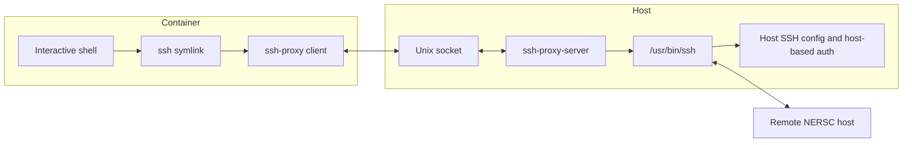

# SSH Proxy Design

The SSH proxy lets a container invoke the host's SSH client over a Unix socket.
This is useful on NERSC systems where host-based SSH authentication, host SSH
configuration, and trusted host identity are available on the host but not
directly reproducible inside the container.

The implementation has two commands:

* `cmd/ssh-proxy`: container-side client. It is also installed as `ssh`, so
  normal commands such as `ssh dtn01.nersc.gov` use the proxy path.
* `cmd/ssh-proxy-server`: host-side server. It listens on a user-scoped Unix
  socket and launches the real host `ssh` executable.

## Flow



## Socket Discovery

Both sides use the same default socket lookup order:

1. `SSH_PROXY_SOCKET`
2. `${XDG_RUNTIME_DIR}/ssh-proxy-<hostname>.sock`
3. `/tmp/vnc-novnc-<uid>/ssh-proxy-<hostname>.sock`

The hostname suffix avoids collisions when a user has concurrent sessions on
multiple login nodes. The `/tmp` fallback keeps the socket node-local when no
usable runtime directory is provided.

The launcher or kernelspec wrapper starts `ssh-proxy-server` only when the
socket is missing. If the socket already exists, startup is skipped so multiple
containers can share the same host-side server.

## Protocol

The client sends one JSON handshake followed by binary frames. The handshake
contains the command name, SSH arguments, selected environment variables,
current working directory, TTY request, and terminal size.

The frame protocol is shared with the Slurm CLI proxy in
`internal/protocol/protocol.go`:

* `STDIN`: container input sent to the host process
* `STDOUT`: host process output sent back to the container
* `STDERR`: host process error output sent back to the container
* `SIGNAL`: forwarded POSIX signal
* `RESIZE`: terminal size update
* `EXIT`: host process exit status
* `ERROR`: server-side startup or validation error

Each frame is encoded as one type byte, a four-byte big-endian payload length,
and the payload bytes.

## TTY Handling

The client automatically requests TTY mode when stdin is a terminal, unless SSH
arguments include `-T`. It forces TTY mode for `-t` or `-tt`.

When TTY mode is active:

* The client puts the local terminal into raw mode.
* Terminal size is sent in the handshake.
* `SIGWINCH` resize events are forwarded with `RESIZE` frames.
* The client restores the terminal state before exiting.

On the server side, interactive SSH sessions are launched through:

```sh
script -qfec '<quoted ssh command>' /dev/null
```

This gives the host SSH process a usable TTY while avoiding container-side
permission issues from trying to allocate the SSH process directly.

## Environment Handling

The server starts from the host environment and only accepts a narrow set of
client-provided overrides:

* `TERM`
* `COLORTERM`
* `LANG`
* `LC_*`

This preserves host SSH behavior while still allowing terminal and locale
settings from the container session to reach the host SSH process.

## Security Boundary

The server only accepts handshakes whose command basename is `ssh`. It does not
provide a general remote command execution service.

The Unix socket should live in a user-private runtime directory. Socket parent
directories are created with mode `0700` by the server setup path.

## Typical Container Integration

The Slurm-enabled noVNC images install:

```text
/usr/local/bin/ssh-proxy
/usr/local/bin/ssh -> /usr/local/bin/ssh-proxy
```

The host-side wrapper or runner sets `SSH_PROXY_SOCKET` in the container and
bind mounts the socket if it is not already visible through an existing mount
such as `/global` or `/tmp`.
