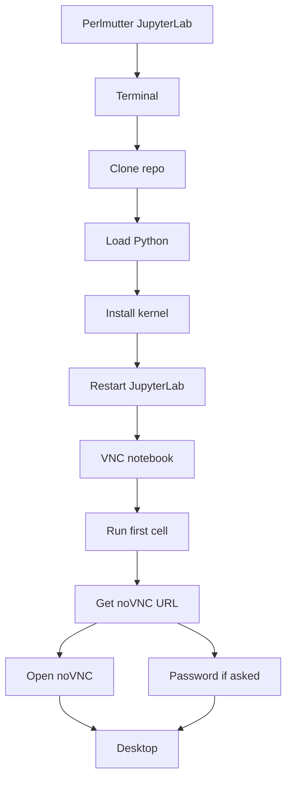
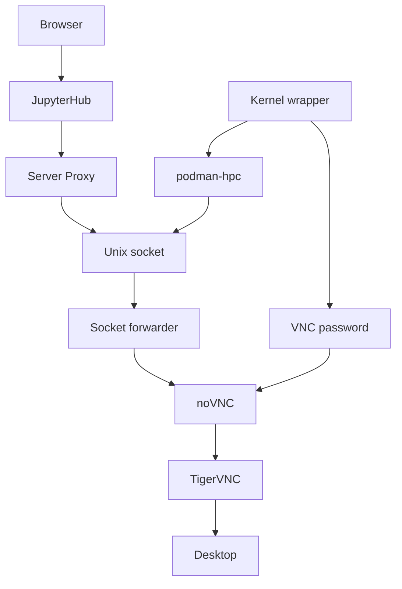

# Jupyter desktop kernels

For Perlmutter setup and registry access, see [scope and prerequisites](perlmutter.md). Run shell commands from the repository root.

## Quickstart: Jupyter Kernel

1. Log in to <https://jupyter.nersc.gov>, start a **Perlmutter** JupyterLab
   server, and open a terminal. Choose a compute-node server for GPU work.

2. Clone this repository in the terminal:

```sh
cd "${HOME}"
git clone https://github.com/nersc/perlmutter-desktop-containers.git
cd perlmutter-desktop-containers
```

3. Load the NERSC Python module:

```sh
module load python
```

   If you have access, log in to the NERSC Registry to use its pull-through
   cache. You can skip this step and the installer will fall back to GHCR:

```sh
podman-hpc login registry.nersc.gov
```

   Install the default openSUSE Leap 15.6 XFCE Slurm kernelspec. This
   variant enables Unix noVNC, the Slurm CLI and host SSH proxies, and GPU
   visibility in the generated kernelspec. `--prepull` makes the selected
   image available during installation so the first kernel startup does not
   have to wait for an image pull. If a migrated `podman-hpc` image is already
   present on Perlmutter scratch, the installer reuses it instead of pulling
   again.

```sh
scripts/install-jupyter-kernel.sh --prepull --force
```

To refresh that image later without reinstalling the kernelspec:

```sh
module load python
scripts/install-jupyter-kernel.sh --prepull-only
```

If the cache pull fails, the installer pre-pulls directly from GHCR. An
installed kernel also retries GHCR if its cached image is unavailable at
startup.

4. After the first Unix-mode install, stop and restart your JupyterLab server
   so it loads the new named proxy service. Create a new notebook with the
   `VNC-opensuse15.6-xfce-slurm` kernel. Refresh JupyterLab if the kernel
   menu has not updated.

The first notebook cell output shows the noVNC login URL and connection
details. Unix-socket kernels still create a random VNC password internally, but
the security boundary is the authenticated Jupyter Server Proxy path plus the
user-private Unix socket, not a host TCP noVNC port. If you need to show the
connection details again:

```python
import vnc_novnc

vnc_novnc.display_connection()
```

Open the noVNC URL in the browser. If noVNC prompts for a VNC password, use the
printed password; otherwise it can be ignored for Unix-socket kernels. Stopping
the kernel stops the noVNC container.

The user workflow is:



## Jupyter Server Proxy URLs

When run inside a Jupyter session, helpers use `JUPYTERHUB_SERVICE_PREFIX` to
build the proxied noVNC URL. Installed kernels use a named Jupyter Server Proxy
service backed by a Unix socket, so no host TCP noVNC port is exposed to other
users on the same node. Jupyter IPC carries notebook kernel channels; it does
not determine the noVNC transport. The standalone runner uses loopback TCP by
default, including with the included config. Unix mode is also available after
the named proxy service is installed, and avoids a host noVNC TCP listener on
multi-user nodes. The Unix socket is under
`/tmp/vnc-novnc-UID/novnc-HOST.sock` by default.

The Unix-mode runtime flow is:



For example, if the service prefix is:

```text
/user/your-user-name/your-server-name/
```

and the named proxy service is `vnc-novnc`, the printed URL is:

```text
https://jupyter.nersc.gov/user/your-user-name/your-server-name/vnc-novnc/vnc.html?port=443&host=jupyter.nersc.gov&path=user%2Fyour-user-name%2Fyour-server-name%2Fvnc-novnc%2Fwebsockify
```

The server name is the segment of your live JupyterLab URL after
`/user/<username>/`; it is not a fixed Perlmutter hostname. If the helper is
not running in a JupyterLab terminal, run it on the same node as that server
and supply its name:

```sh
python3 scripts/run-vnc-novnc.py --jupyter-proxy-server your-server-name
```

## Jupyter Kernel

Install the default openSUSE Leap 15.6 XFCE Slurm kernelspec:

```sh
scripts/install-jupyter-kernel.sh --prepull --force
```

This installs the Python package in editable mode for the current user and
copies the selected kernelspec into:

```text
${HOME}/.local/share/jupyter/kernels/vnc-novnc-opensuse15.6-xfce-slurm
```

With Unix noVNC transport, this uses the
`registry.nersc.gov/ghcr.io/nersc/perlmutter-desktop-containers:opensuse15.6-xfce-slurm-unix` image.
The kernelspec directory is `vnc-novnc-opensuse15.6-xfce-slurm`; the display
name is `VNC-opensuse15.6-xfce-slurm`.

Useful installer options:

| Option | Purpose |
| --- | --- |
| No variant arguments | Install the openSUSE Leap 15.6 XFCE Slurm kernel with Unix noVNC, host SSH proxy, and Perlmutter PE settings. |
| `DISTRO DESKTOP` | Select the image variant, for example `ubuntu24.04 xfce` or `opensuse15.6 xfce`. |
| `--distro DISTRO`, `--desktop DESKTOP` | Select the same variant with explicit options. |
| `--all` | Install one kernelspec for every supported distro/desktop combination. |
| `--prepull` | Ensure each selected image is available while installing kernelspecs; existing local or migrated `podman-hpc` images are reused. |
| `--prepull-only` | Ensure selected images are available without installing kernelspecs. |
| `--podman-hpc COMMAND` | Choose the `podman-hpc` command used by `--prepull`. |
| `--source-wrapper` | Make the installed kernel wrapper import `vnc_novnc` directly from this checkout. Default behavior. |
| `--no-source-wrapper` | Do not add this checkout to `PYTHONPATH` in the installed wrapper. |
| `--novnc-transport unix\|tcp` | Choose noVNC exposure mode for the installed kernel. Default: `unix`. Use `tcp` as a fallback if Jupyter Server Proxy Unix sockets are unavailable. |
| `--novnc-socket PATH` | Override the noVNC Unix socket path in the generated kernel config and Jupyter proxy config. |
| `--jupyter-proxy-service NAME` | Named Jupyter Server Proxy service used by Unix socket mode. Default: `vnc-novnc`. |
| `--jupyter-proxy-only` | Install only the named Unix socket proxy service for manual runs; restart JupyterLab afterward. |
| `--display-mode MODE` | Set the kernelspec display preset. Use `1080p`, `fhd`, or `high` for `1920x1080` with `VNC_DEPTH=32`; non-default modes get a suffix in the default kernelspec name. |
| `--slurm`, `--no-slurm` | Enable or disable `scli` socket setup in the generated kernelspec. Slurm image variants enable it automatically. |
| `--ssh-proxy`, `--no-ssh-proxy` | Enable or disable host SSH proxy socket setup in the generated kernelspec. Slurm image variants enable it automatically. |
| `--no-pip-install` | Copy the kernelspec without running `pip install`. |
| `--prefix DIR` | Install under `DIR/share/jupyter/kernels`. |
| `--name NAME` | Override the default kernelspec directory name. |
| `--display-name NAME` | Override the Jupyter display name. |
| `--force` | Replace an existing kernelspec directory. |
| `--list-variants` | Print supported distro/desktop combinations. |

Examples:

```sh
scripts/install-jupyter-kernel.sh --prepull --force
scripts/install-jupyter-kernel.sh ubuntu24.04 xfce --force
scripts/install-jupyter-kernel.sh ubuntu24.04 xfce-slurm --force
scripts/install-jupyter-kernel.sh opensuse15.6 xfce --force
scripts/install-jupyter-kernel.sh --display-mode 1080p opensuse15.6 xfce-slurm --force
scripts/install-jupyter-kernel.sh --all --force
scripts/install-jupyter-kernel.sh --all --prepull --force
scripts/install-jupyter-kernel.sh ubuntu24.04 xfce --prepull-only
scripts/install-jupyter-kernel.sh --all --prepull-only
```

To disable checkout-based imports and rely only on the Python package install:

```sh
scripts/install-jupyter-kernel.sh --no-source-wrapper --force
```

Restart the Jupyter session after the first Unix-mode install so the
`vnc-novnc` Jupyter Server Proxy service is loaded. Restart or refresh
JupyterLab if the new kernel does not appear immediately.

For `opensuse15.6 xfce-slurm`, Unix-mode installs use the separate image tag
`registry.nersc.gov/ghcr.io/nersc/perlmutter-desktop-containers:opensuse15.6-xfce-slurm-unix`
so the TCP-mode image tag remains unchanged.

## Kernel Behavior

When Jupyter starts a VNC/noVNC kernel, the host wrapper runs the Python
interpreter that installed the kernelspec:

```sh
/path/to/install/python -m vnc_novnc.kernel --config "{resource_dir}/vnc-novnc.yaml" -f "{connection_file}"
```

The wrapper:

- Uses the Jupyter connection file as provided by the NERSC Jupyter server.
  NERSC starts the single-user server with IPC transport, so notebook kernel
  channels avoid host TCP port mappings and host networking without a custom
  kernelspec provisioner.
- Uses a user-private noVNC Unix socket when `novnc_transport: unix` is set, or
  chooses an available host port when `novnc_transport: tcp`.
- Generates a random VNC password for the internal TigerVNC server.
- Writes the password to a temporary `0600` file on the host.
- Mounts that file read-only at `/run/secrets/vnc-password` inside the
  container.
- Mounts the noVNC socket directory into the container for Unix mode; publishes
  noVNC on the selected host port for TCP mode.
- Names the container and explicitly stops/removes it if the host wrapper
  receives `INT`, `TERM`, or `HUP`.
- Runs `podman-hpc` with `--jupyter`, matching the NERSC documented kernel
  pattern for mounting Jupyter runtime paths.
- Passes `--userns=keep-id` and `--group-add=keep-groups` from the YAML config.
- Mounts the `scli-server` Unix socket and sets `SCLI_SOCKET` when `slurm: true`
  is set in the YAML config.
- Mounts the `ssh-proxy-server` Unix socket and sets `SSH_PROXY_SOCKET` when
  `ssh_proxy: true` is set in the YAML config.
- Adds a `--passwd-entry` for the host UID when `keep-id` is active so the
  notebook user resolves to `/bin/bash` inside the container.
- Mounts `/global`, `$SCRATCH`, `$CFS`, `/opt`, the host Cray PE config,
  the host cluster name, and the host environment file from the YAML config.
- Passes the NERSC module and programming environment variables from the YAML
  config.
- In the openSUSE Slurm image, initializes the mounted host Lmod/Cray PE stack
  and restores the NERSC default module collection before the VNC desktop starts.
- Passes non-secret noVNC connection metadata into the container.

Inside the container, `vnc-novnc-jupyter-kernel` starts VNC/noVNC in the
background and then starts `ipykernel`. For Unix mode, websockify listens only
on container loopback and a small Unix socket forwarder accepts connections
from the mounted socket path. The openSUSE Slurm Unix image does not declare
`6080/tcp` as exposed image metadata, so `podman-hpc ps` does not advertise a
noVNC TCP port for new Unix-mode containers. Raw VNC remains internal unless a
runner explicitly publishes it.

After selecting a `VNC-DISTRO-DESKTOP` kernel, the noVNC URL and connection
details are displayed automatically in the first notebook cell output. In
Unix-socket mode, the printed VNC password is an internal fallback and is only
needed if noVNC prompts for it. To show the details again manually:

```python
import vnc_novnc

vnc_novnc.display_connection()
```

The sample kernel config is `jupyter/kernelspec/vnc-novnc.yaml`:

```yaml
image: registry.nersc.gov/ghcr.io/nersc/perlmutter-desktop-containers:opensuse15.6-xfce-slurm-unix
userns: keep-id
keep_groups: true
pull_policy: missing
display_mode: default
novnc_transport: unix
novnc_socket:
jupyter_proxy_service: vnc-novnc
gpu: true
slurm: true
ssh_proxy: true

volume:
  - "/global:/global"
  - "${SCRATCH}:${SCRATCH}:rw"
  - "${CFS}:${CFS}:rw"
  - "/opt:/opt"
  - "/etc/cray-pe.d:/etc/cray-pe.d:ro"
  - "/etc/clustername:/etc/clustername:ro"
  - "/etc/environment:/etc/environment:ro"

env:
  - "HOME"
  - "MODULEPATH"
  - "MODULEPATH_ROOT"
  - "MODULESHOME"
  - "PE_ENV"
  - "LMOD_FAMILY_MPI"
  - "LMOD_FAMILY_CUDATOOLKIT"
  - "LMOD_FAMILY_CUDATOOLKIT_VERSION"
```

`/tmp` is added directly by the Jupyter kernel wrapper. `$HOME` on Perlmutter is
covered by the `/global:/global` mount.

For a desktop without a Jupyter kernel, see the [manual runner guide](manual-runner.md). For Slurm and host SSH, see [host proxies](proxies.md).
