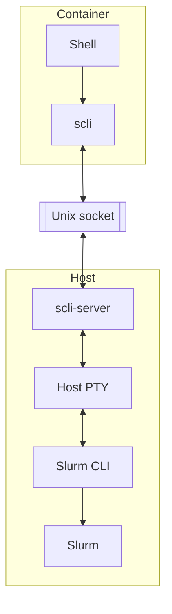
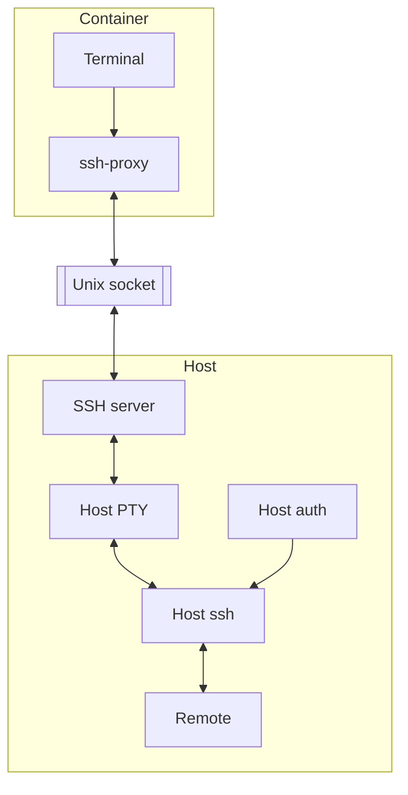

# Slurm and host SSH proxies

From a desktop terminal, you can run Slurm job commands such as `srun`,
`sbatch`, and `squeue`, as well as `ssh`. Small proxy programs pass those
commands to the Perlmutter host over private Unix sockets, where your existing
Slurm and SSH setup can handle them. This page describes those programs.

See [image variants](images.md) for available tags and
[Jupyter desktop setup](jupyter.md) for installation. Run shell commands from
the repository root.

The `ubuntu24.04 xfce-slurm` and `opensuse15.6 xfce-slurm` images include the
`scli` client and Slurm command symlinks (`srun`, `sbatch`, `squeue`, and
related commands). They also include an `ssh` shim that can proxy SSH through a
host-side `ssh-proxy-server`, which lets container shells use the host's SSH
configuration and host-based authentication for destinations such as NERSC DTNs.
The openSUSE Slurm variant also installs native GCC 7, 12, 13, and 14 packages
to match Perlmutter host compiler module expectations more closely. The Slurm
and SSH proxy source is included under
[`host-proxies`](../host-proxies). Slurm-enabled
kernelspecs set `gpu: true`, which adds `--gpu` to
`podman-hpc run` so host GPUs are visible in the container. This does not yet
make the VNC display itself use GPU-accelerated OpenGL rendering; Xvnc uses Mesa
software rendering today. VirtualGL/EGL integration for hardware-accelerated
OpenGL inside the VNC display is planned for a future update. Installing a
Slurm-enabled kernelspec pulls the `host-proxies-linux-amd64` package through
the NERSC Registry cache, falling back to GHCR if needed. The installer checks
the SHA-256 hashes and places `scli-server` in `${HOME}/bin/scli-server` and
`ssh-proxy-server` in `${HOME}/bin/ssh-proxy-server`. With `--slurm`, the launcher starts
`scli-server` if the socket is not already present, then mounts the Unix socket
and sets `SCLI_SOCKET` inside the container. With `--ssh-proxy`, it does the
same for `ssh-proxy-server` and `SSH_PROXY_SOCKET`. Socket defaults are
hostname-qualified to avoid stale sockets when `${HOME}` is shared across login
nodes:

```text
SCLI_SOCKET, then ${XDG_RUNTIME_DIR}/scli-$(hostname).sock,
then /tmp/vnc-novnc-$(id -u)/scli-$(hostname).sock

SSH_PROXY_SOCKET, then ${XDG_RUNTIME_DIR}/ssh-proxy-$(hostname).sock,
then /tmp/vnc-novnc-$(id -u)/ssh-proxy-$(hostname).sock
```

The Slurm proxy carries command requests and interactive I/O over the mounted
Unix socket. The container client does not directly attach to a host TTY; when
TTY mode is requested, the host-side server owns the host PTY or pipe endpoints
and sends stdin/stdout/stderr frames through the socket.



The SSH proxy uses the same framing model. The container-side `ssh` shim puts
the local container terminal into raw mode when needed, but the real host SSH
process talks to a host-side PTY or pipes managed by `ssh-proxy-server`.



```sh
python3 scripts/run-vnc-novnc.py \
  --config config/perlmutter-runner.yaml \
  --image registry.nersc.gov/ghcr.io/nersc/perlmutter-desktop-containers:opensuse15.6-xfce-slurm-unix \
  --novnc-transport unix \
  --gpu \
  --slurm \
  --ssh-proxy
```
